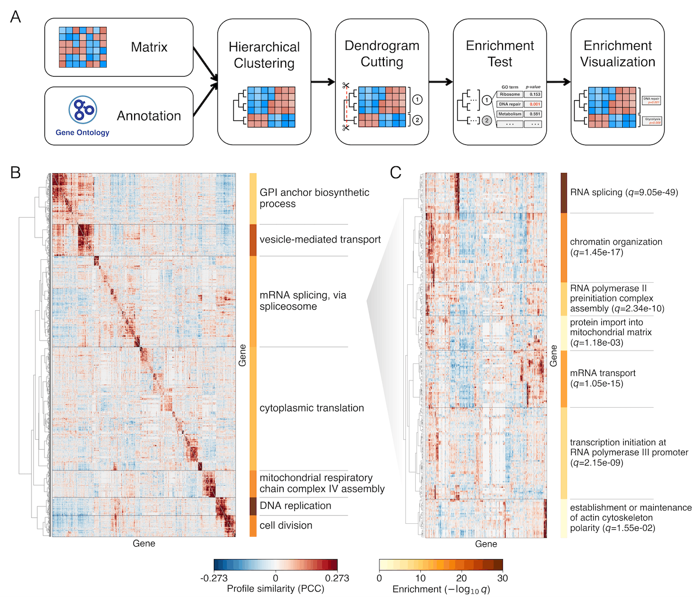

# HiMaLAYAS Documentation


[](https://pypi.python.org/pypi/himalayas)
[](LICENSE)

This documentation describes Hierarchical Matrix Layout and Annotation Software (HiMaLAYAS), a framework for post hoc enrichment-based annotation and visualization of hierarchically clustered matrices. HiMaLAYAS treats dendrogram-defined clusters as statistical units, tests categorical annotations for enrichment, controls multiple testing, and renders significant annotations alongside clusters. It supports biological and non-biological domains.

- **Full Documentation**: [himalayas-base.github.io/himalayas-docs](https://himalayas-base.github.io/himalayas-docs)
- **Figure Gallery**: [himalayas-base.github.io/himalayas-docs/11_figure_gallery](https://himalayas-base.github.io/himalayas-docs/11_figure_gallery/)
- **Try in Browser (Binder)**:
  - Quickstart: [](https://mybinder.org/v2/gh/himalayas-base/himalayas-docs/v0.0.17?filepath=notebooks/quickstart.ipynb)
  - Advanced Quickstart: [](https://mybinder.org/v2/gh/himalayas-base/himalayas-docs/v0.0.17?filepath=notebooks/quickstart_advanced.ipynb)
- **Source Code**: [github.com/himalayas-base/himalayas](https://github.com/himalayas-base/himalayas)

For a full description of HiMaLAYAS and its applications, see:
<br>
Horecka, I., and Röst, H. (2026)
<br>
_HiMaLAYAS: enrichment-based annotation and visualization of hierarchically clustered matrices_
<br>
_bioRxiv_. [https://www.biorxiv.org/content/10.64898/2026.02.11.705303v3](https://www.biorxiv.org/content/10.64898/2026.02.11.705303v3)
<br>
Submitted to _Bioinformatics Advances_.

## Yeast Genetic Interaction Matrix Demonstration

HiMaLAYAS is applied to a hierarchically clustered
_Saccharomyces cerevisiae_ genetic interaction profile similarity matrix
(Costanzo _et al_., 2016), focusing on 1,053 genes with high profile variance.
Dendrogram-defined clusters were tested for Gene Ontology Biological Process
(GO BP; Ashburner _et al_., 2000) enrichment, with top-ranked significant
annotations rendered alongside clusters.


**HiMaLAYAS workflow and application to a hierarchically clustered yeast
genetic interaction profile similarity matrix (Costanzo _et al_., 2016)**.
A real-valued matrix and categorical annotations serve as inputs. HiMaLAYAS
hierarchically clusters the matrix, cuts the dendrogram at a user-defined
distance threshold, tests categorical annotations for enrichment, controls
multiple testing, and renders significant annotations alongside clusters.

## Quickstart

Example inputs are bundled in `notebooks/data`: the [yeast matrix](notebooks/data/gi_pcc_sampled.tsv) and matching [GO BP annotations](notebooks/data/go_bp_name_to_orfs.json). Run the loading examples from `notebooks/`, where these files resolve as `data/...`. In this development checkout, the [basic quickstart](notebooks/quickstart.ipynb#Annotate-the-same-clusters-with-other-GO-categories) also compares BP, CC and MF on the same clusters using the bundled [CC](notebooks/data/go_cc_name_to_orfs.json) and [MF](notebooks/data/go_mf_name_to_orfs.json) mappings; see their [provenance](notebooks/data/go_cc_mf_provenance.md).

**Try in Browser (Binder)**

- [Launch Quickstart in Binder](https://mybinder.org/v2/gh/himalayas-base/himalayas-docs/v0.0.17?filepath=notebooks/quickstart.ipynb)
- [Launch Advanced Quickstart in Binder](https://mybinder.org/v2/gh/himalayas-base/himalayas-docs/v0.0.17?filepath=notebooks/quickstart_advanced.ipynb)

**Local Run**

```bash
git clone --branch v0.0.17 https://github.com/himalayas-base/himalayas-docs.git
cd himalayas-docs
python -m venv .venv
source .venv/bin/activate
python -m pip install -r requirements.txt
cd notebooks
jupyter notebook
```

Open `quickstart.ipynb` or `quickstart_advanced.ipynb` in Jupyter. The kernel working directory must be `notebooks/` so the bundled `data/` files resolve.

### Tutorial dependency and HTML builds

These development tutorials require the 0.0.17 APIs, including `drop_redundant`. Until 0.0.17 is published, `requirements.txt` installs the immutable source snapshot `f824e7f8447519ead93995742eb0aa0a7e483d32` instead of assuming an unpublished PyPI release exists. This snapshot includes the tutorial APIs and reviewed background and plotting fixes. Binder uses the same requirements. Remote launch links target the `v0.0.17` documentation branch and require that branch and the source commit to be available on GitHub.

For local development, first install the requirements above, then run `python -m pip install --no-deps -e ../himalayas` from the documentation repository root to use the sibling library checkout. Confirm the selected source with `python -c "import himalayas; print(himalayas.__version__, himalayas.__file__)"`.

After the release is published, replace the source requirement with `himalayas==0.0.17` and rerun both notebooks before regenerating HTML. The published version must supply all tutorial APIs.

From the documentation repository root, execute and save both notebooks with Jupyter (using the `notebooks/` working directory), then run:

```bash
make quickstarts-html
```

This target converts saved outputs; it does not execute notebooks. Validate both notebooks through their final optional sections before converting. `SAVE_FIGURES=False` keeps execution from creating local figure exports. A successful local run does not verify the hosted Binder build.

## Citation

### Primary citation

Horecka, I., and Röst, H. (2026)
<br>
_HiMaLAYAS: enrichment-based annotation and visualization of hierarchically clustered matrices_
<br>
_bioRxiv_. [https://www.biorxiv.org/content/10.64898/2026.02.11.705303v3](https://www.biorxiv.org/content/10.64898/2026.02.11.705303v3)
<br>
Submitted to _Bioinformatics Advances_.

### Software archive

HiMaLAYAS software archive.
<br>
Zenodo. [https://doi.org/10.5281/zenodo.18610373](https://doi.org/10.5281/zenodo.18610373)

## License

This documentation follows the [BSD 3-Clause License](LICENSE).
